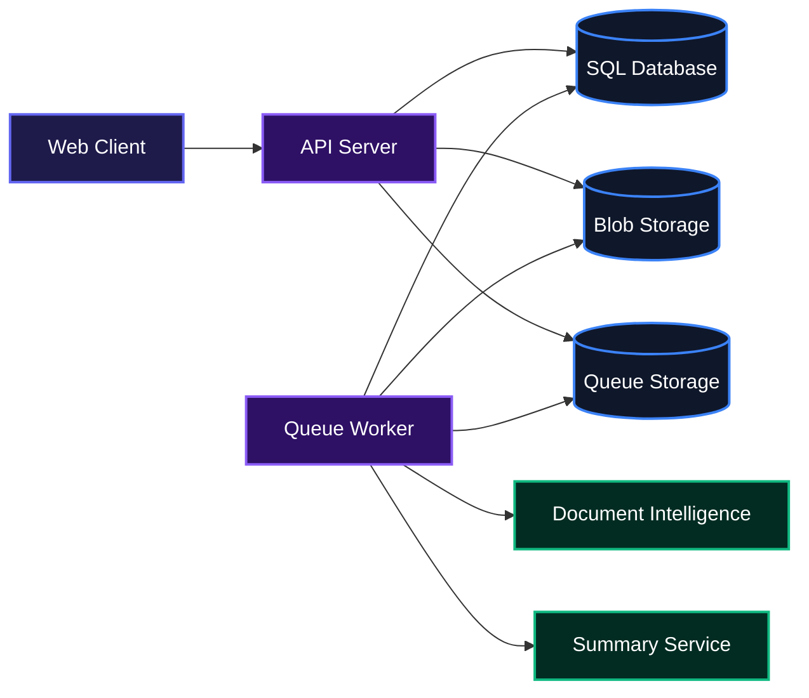
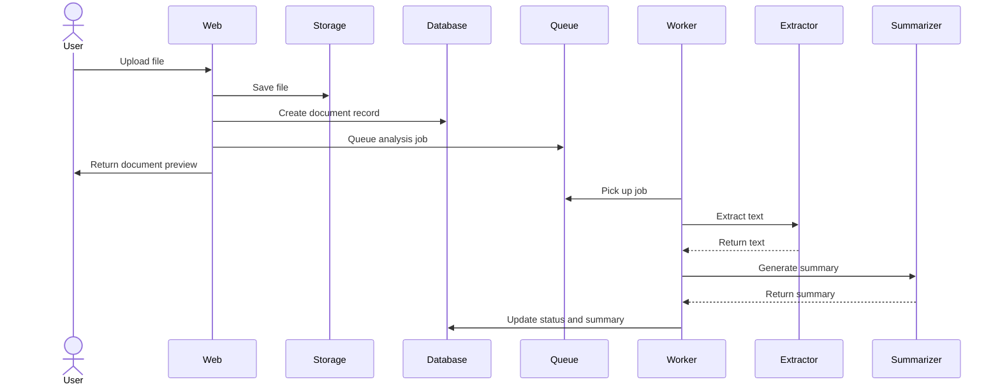
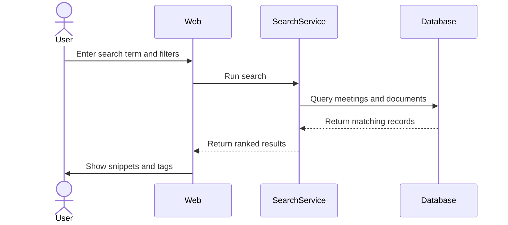
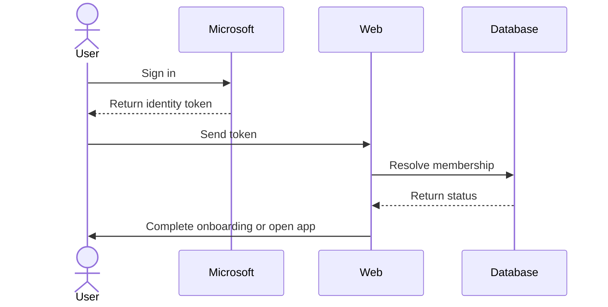

# Archiva

Archiva is a secure meeting and document management platform that helps organizations capture, organize, and search their records in one place. Teams can schedule meetings, attach files, and find information quickly without digging through email or shared drives. Uploaded documents are automatically processed so users can read concise summaries and search inside the content, while every organization's data stays isolated and access is handled through Microsoft accounts.



## Features

- **Meeting management**: Create, update, and delete meetings with titles, descriptions, dates, locations, and tags.
- **Document upload and storage**: Attach PDF, Word, Excel, or plain text files to meetings. Files are stored privately and served through short-lived signed links.
- **Automated document analysis**: Background workers extract text and generate concise English summaries while respecting usage budgets and per-document limits.
- **Full-text search**: Search across meeting titles, descriptions, and document contents with filters for tags and date ranges.
- **Organization-based access control**: Users sign in with Microsoft accounts, join organizations through invitations, and only see their own organization's data.
- **Dashboard insights**: A quick view of meeting counts, document counts, and meetings added in the last seven days.
- **Resilient background processing**: Queue-based analysis with lease management, retries, reconciliation, and clear status tracking.

### Document Upload and Analysis



### Search



### Sign In and Organization Onboarding



## Installation

Prerequisites:

- [.NET 10 SDK](https://dotnet.microsoft.com/download/dotnet/10.0)
- [Docker](https://www.docker.com/) (for local Aspire dependencies such as Azurite and the SQL Server container)
- An IDE such as Visual Studio, VS Code, or JetBrains Rider

Clone the repository:

```bash
git clone https://github.com/ArchivaLabs/archiva-backend.git
cd archiva-backend
```

Build the solution:

```bash
dotnet build
```

Run the application through the Aspire app host:

```bash
dotnet run --project src/AppHost
```

The Aspire dashboard will open automatically and show the API URL and logs. The API is available through the `webapi` resource.

You can also open the project in the provided Dev Container. In VS Code, install the Dev Containers extension, open the repository, and select **Reopen in Container**.

## Usage

Once the app is running, sign in with a Microsoft account, create an organization, and start adding meetings and documents. The API is interactive in development at the Scalar reference page linked from the Aspire dashboard.

Create a meeting:

```bash
curl -X POST https://localhost:5150/api/meetings \
  -H "Authorization: Bearer <your-jwt>" \
  -H "Content-Type: application/json" \
  -d '{
    "title": "Budget Planning Committee",
    "description": "Annual budget allocation discussion",
    "meetingDate": "2026-10-20",
    "meetingTime": "09:00:00",
    "utcOffsetMinutes": -60,
    "location": "Finance Office, Room 201",
    "tags": ["Finance", "Executive"]
  }'
```

Search meetings and documents:

```bash
curl -X POST https://localhost:5150/api/search \
  -H "Authorization: Bearer <your-jwt>" \
  -H "Content-Type: application/json" \
  -d '{
    "searchTerm": "budget",
    "page": 1,
    "pageSize": 20,
    "sortBy": "relevance",
    "includeMeetings": true,
    "includeDocuments": true,
    "searchTitles": true,
    "searchContent": true,
    "tags": ["Finance"]
  }'
```

Run the test suite:

```bash
dotnet test
```

## API Documentation

All endpoints require a valid Microsoft-issued JWT Bearer token unless noted otherwise.

### POST /api/auth/sync

Syncs the authenticated user with the database after Microsoft login.

**Request:** empty body

**Response:**
```json
{
  "status": "existing",
  "organizationId": 1,
  "displayName": "Ada Lovelace",
  "email": "ada@example.com",
  "avatarUrl": null,
  "organizationName": "University of Abuja",
  "organizationUrl": null,
  "role": "Admin",
  "userId": "00000000-0000-0000-0000-000000000000"
}
```

**Errors:**
- 401: No valid Microsoft token was provided.
- 400: Validation failure.

### GET /api/dashboard/stats

Returns aggregate counts for the current user's organization.

**Response:**
```json
{
  "meetingCount": 30,
  "documentCount": 12,
  "meetingsAddedThisWeek": 3
}
```

### GET /api/meetings

Returns a paginated list of meetings for the current organization.

**Query parameters:**
- `page` (optional, default 1)
- `pageSize` (optional, default 10, max 50)

**Response:**
```json
{
  "meetings": [
    {
      "id": 1,
      "title": "Senate General Assembly",
      "description": "Full senate session for Q3 review.",
      "meetingDate": "2026-08-01T10:00:00",
      "meetingTime": "10:00:00",
      "location": "Senate Chamber, Block A",
      "createdBy": "Seed User",
      "createdByAvatar": null,
      "createdById": "seed-user-local-development",
      "canDelete": true,
      "tags": ["Senate", "Governance"],
      "documentCount": 0,
      "created": "2026-08-01T00:00:00+00:00"
    }
  ],
  "totalCount": 30,
  "page": 1,
  "pageSize": 10,
  "totalPages": 3,
  "hasNextPage": true,
  "hasPreviousPage": false
}
```

### POST /api/meetings

Creates a future meeting for the current organization.

**Request:**
```json
{
  "title": "Budget Planning Committee",
  "description": "Annual budget allocation discussion",
  "meetingDate": "2026-10-20",
  "meetingTime": "09:00:00",
  "utcOffsetMinutes": -60,
  "location": "Finance Office, Room 201",
  "tags": ["Finance", "Executive"]
}
```

**Response:**
```json
{
  "id": 31,
  "title": "Budget Planning Committee",
  "description": "Annual budget allocation discussion",
  "meetingDate": "2026-10-20T00:00:00",
  "meetingTime": "09:00:00",
  "location": "Finance Office, Room 201",
  "organizationId": 1,
  "tags": ["Finance", "Executive"]
}
```

**Errors:**
- 400: Validation failure (missing title, invalid date, past date, etc.).
- 401: User is not authenticated.
- 403: User does not belong to an organization.

### GET /api/meetings/{id}

Returns the full details of a meeting, including its documents and tags.

**Response:** same shape as `MeetingDetailDto`, which includes a nested `documents` array.

**Errors:**
- 401: User is not authenticated.
- 404: Meeting does not exist or belongs to another organization.

### PUT /api/meetings/{id}

Updates a meeting's title, description, date, time, location, and tags.

**Request:**
```json
{
  "title": "Updated Budget Planning Committee",
  "description": "Updated description",
  "meetingDate": "2026-10-21",
  "meetingTime": "10:00:00",
  "location": "Finance Office, Room 202",
  "tags": ["Finance"]
}
```

**Response:** updated `MeetingDetailDto`.

**Errors:**
- 400: Validation failure.
- 401: User is not authenticated.
- 404: Meeting not found.

### DELETE /api/meetings/{id}

Permanently deletes a meeting and all of its documents from the database and storage.

**Response:** `204 No Content`

**Errors:**
- 401: User is not authenticated.
- 403: User is not allowed to delete this meeting.
- 404: Meeting not found.

### GET /api/meetings/{meetingId}/documents

Returns all documents uploaded to the specified meeting.

**Response:**
```json
[
  {
    "id": 1,
    "fileName": "agenda.pdf",
    "fileType": "PDF",
    "fileSizeInBytes": 102400,
    "blobUrl": "https://...",
    "description": "Meeting agenda",
    "uploadedBy": "Ada Lovelace",
    "created": "2026-10-20T09:00:00+00:00",
    "analysisStatus": "Completed",
    "analysisErrorCode": null,
    "summary": "The agenda covers budget review...",
    "analysisCompletedAt": "2026-10-20T09:05:00+00:00"
  }
]
```

### POST /api/meetings/{meetingId}/documents

Uploads a file to a meeting. Accepted formats are PDF, DOCX, XLSX, and TXT, with a maximum size of 10 MB.

**Request:** `multipart/form-data`
- `file`: the file to upload
- `description` (optional): a short description

**Response:** the created `DocumentDto`.

**Errors:**
- 400: Invalid file type, empty file, or file too large.
- 401: User is not authenticated.
- 404: Meeting not found.

### GET /api/documents/{documentId}

Returns the detail view for a single document, including a fresh short-lived read URL.

**Response:**
```json
{
  "id": 1,
  "fileName": "agenda.pdf",
  "fileType": "PDF",
  "fileSizeInBytes": 102400,
  "blobUrl": "https://...",
  "description": "Meeting agenda",
  "uploadedBy": "Ada Lovelace",
  "created": "2026-10-20T09:00:00+00:00",
  "meetingId": 5,
  "meetingTitle": "Budget Planning Committee",
  "meetingDate": "2026-10-20T00:00:00",
  "tags": ["Finance", "Executive"],
  "analysisStatus": "Completed",
  "analysisErrorCode": null,
  "summary": "The agenda covers budget review...",
  "billableUnitCount": 1,
  "summaryInputCharacters": 2500,
  "analysisCompletedAt": "2026-10-20T09:05:00+00:00"
}
```

**Errors:**
- 401: User is not authenticated.
- 404: Document not found.

### GET /api/documents/{documentId}/content

Returns the raw file bytes for document preview or download.

**Response:** file content with the appropriate `Content-Type` header.

**Errors:**
- 401: User is not authenticated.
- 404: Document not found.

### POST /api/documents/{documentId}/analysis/retry

Queues a failed or deferred document for re-analysis. Restricted to organization admins.

**Request:**
```json
{
  "unitLimit": 100,
  "summaryLimit": 200000
}
```

**Response:**
```json
{
  "documentId": 5,
  "analysisStatus": "Pending"
}
```

**Errors:**
- 400: Document cannot be retried in its current state, or limits are invalid.
- 401: User is not authenticated.
- 403: User is not an admin.
- 404: Document not found.

### POST /api/documents/analysis/backfill

Queues a batch of older documents for analysis. Restricted to organization admins.

**Request:**
```json
{
  "afterDocumentId": 0,
  "batchSize": 100
}
```

**Response:**
```json
{
  "queuedCount": 42,
  "nextAfterDocumentId": 57
}
```

**Errors:**
- 400: Invalid batch parameters.
- 401: User is not authenticated.
- 403: User is not an admin.

### POST /api/organizations

Creates a new organization and makes the calling user the admin.

**Request:**
```json
{
  "name": "Acme University",
  "logoUrl": "https://example.com/logo.png"
}
```

**Response:**
```json
{
  "organizationId": 2,
  "role": "Admin",
  "userId": "00000000-0000-0000-0000-000000000000",
  "organizationName": "Acme University",
  "organizationLogoUrl": "https://example.com/logo.png"
}
```

**Errors:**
- 400: Validation failure or user already belongs to an organization.
- 401: User is not authenticated.

### POST /api/search

Searches meetings and documents within the current organization.

**Request:**
```json
{
  "searchTerm": "budget",
  "page": 1,
  "pageSize": 20,
  "sortBy": "relevance",
  "includeMeetings": true,
  "includeDocuments": true,
  "searchTitles": true,
  "searchContent": true,
  "dateFrom": "2026-01-01",
  "dateTo": "2026-12-31",
  "tags": ["Finance"]
}
```

**Response:**
```json
{
  "results": [
    {
      "id": 1,
      "type": "meeting",
      "title": "Budget Planning Committee",
      "snippet": "Annual budget allocation discussion...",
      "meetingDate": "2026-10-20T00:00:00",
      "source": "Budget Planning Committee",
      "fileType": null,
      "tags": ["Finance", "Executive"],
      "meetingId": 1
    }
  ],
  "totalCount": 1,
  "page": 1,
  "pageSize": 20
}
```

**Errors:**
- 400: Validation failure.
- 401: User is not authenticated.

### GET /api/search/filter-options

Returns the list of tags available for filtering search results in the current organization.

**Response:**
```json
{
  "tags": ["Finance", "Legal", "HR", "Strategy", "Compliance"]
}
```

## Environment Variables

| Variable | Purpose | Example |
|---|---|---|
| `ASPNETCORE_ENVIRONMENT` | Runtime environment | `Development` |
| `AzureAd:TenantId` | Microsoft Entra tenant ID | `common` or a GUID |
| `AzureAd:ClientId` | Microsoft Entra app client ID | `1274d0e7-b545-4dcc-8c4d-005dee797414` |
| `AzureAd:Audience` | JWT audience | `api://1274d0e7-b545-4dcc-8c4d-005dee797414` |
| `AllowedOrigins` | JSON array of allowed frontend origins | `["http://localhost:5173"]` |
| `ConnectionStrings__ArchivaDb` | SQL Server connection string | `Server=...;Database=ArchivaDb;...` |
| `ConnectionStrings__blobs` / `BLOBS_URI` | Blob storage endpoint | `https://...blob.core.windows.net/` |
| `DocumentIntelligence__Endpoint` | Document Intelligence endpoint | `https://...cognitiveservices.azure.com/` |
| `AzureOpenAI__Endpoint` | Azure OpenAI endpoint | `https://....openai.azure.com/` |
| `AzureOpenAI__DeploymentName` | Model deployment name | `gpt-4.1-mini` |
| `APPLICATIONINSIGHTS_CONNECTION_STRING` | Optional telemetry connection string | `InstrumentationKey=...` |
| `AZURE_CLIENT_ID` | Optional managed identity client ID for deployment | `...` |
| `Seed:UserId`, `Seed:UserName`, `Seed:Email` | Optional local development seed user | `your-oid`, `Your Name`, `you@example.com` |

## Technologies Used

| Technology | Purpose | Link |
|---|---|---|
| .NET 10 | Backend framework and runtime | [https://dotnet.microsoft.com](https://dotnet.microsoft.com) |
| ASP.NET Core | Web API and minimal API endpoints | [https://dotnet.microsoft.com/apps/aspnet](https://dotnet.microsoft.com/apps/aspnet) |
| Entity Framework Core | Data access and migrations | [https://learn.microsoft.com/ef/core](https://learn.microsoft.com/ef/core) |
| SQL Server | Relational database | [https://www.microsoft.com/sql-server](https://www.microsoft.com/sql-server) |
| Azure Blob Storage | Private file storage | [https://azure.microsoft.com/services/storage/blobs](https://azure.microsoft.com/services/storage/blobs) |
| Azure Queue Storage | Analysis job queue | [https://azure.microsoft.com/services/storage/queues](https://azure.microsoft.com/services/storage/queues) |
| Azure Document Intelligence | OCR and text extraction | [https://azure.microsoft.com/services/ai-document-intelligence](https://azure.microsoft.com/services/ai-document-intelligence) |
| Azure OpenAI | Document summarization | [https://azure.microsoft.com/services/openai](https://azure.microsoft.com/services/openai) |
| Microsoft Identity Web | Microsoft Entra authentication | [https://github.com/AzureAD/microsoft-identity-web](https://github.com/AzureAD/microsoft-identity-web) |
| MediatR | CQRS command and query handling | [https://github.com/jbogard/MediatR](https://github.com/jbogard/MediatR) |
| FluentValidation | Input validation | [https://docs.fluentvalidation.net](https://docs.fluentvalidation.net) |
| AutoMapper | DTO mapping | [https://automapper.org](https://automapper.org) |
| Scalar | OpenAPI reference UI | [https://github.com/scalar/scalar](https://github.com/scalar/scalar) |
| .NET Aspire | Local orchestration and cloud deployment | [https://learn.microsoft.com/dotnet/aspire](https://learn.microsoft.com/dotnet/aspire) |
| NUnit | Unit and integration testing | [https://nunit.org](https://nunit.org) |

## Contributing

Contributions are welcome. If you want to add a feature, fix a bug, or improve documentation, please open an issue first so we can discuss the change. Keep pull requests focused, add tests where appropriate, and follow the existing code style enforced by the EditorConfig.

## Author

- LinkedIn: [https://linkedin.com/in/lancer18](https://linkedin.com/in/lancer18)
- X (Twitter): [https://x.com/Lansa_18](https://x.com/Lansa_18)

[](https://dotnet.microsoft.com)
[](https://dotnet.microsoft.com/apps/aspnet)
[](https://learn.microsoft.com/ef/core)
[](https://www.microsoft.com/sql-server)
[](https://azure.microsoft.com)
[](https://www.openapis.org)
[](https://github.com/jbogard/MediatR)
[](https://docs.fluentvalidation.net)
[](https://nunit.org)

[](https://dokugen.samueltuoyo.com)